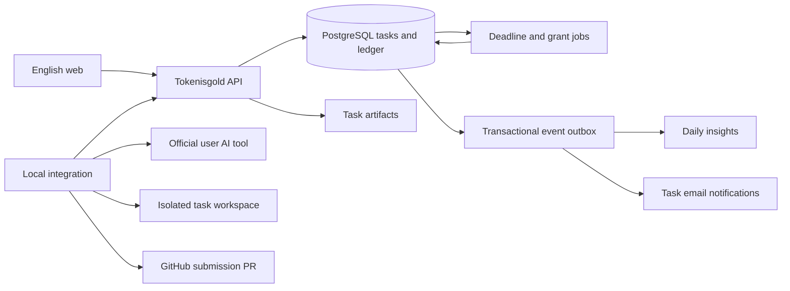

# Tokenisgold 시스템 경계 — TH-001 초안

TypeScript + PostgreSQL은 P-054 승인 사항이다. framework·버전·호스팅은 아직 검토 중이며 현재 Node 버전이 최종 런타임이라는 뜻은 아니다.

Git은 코드/인계물 버전 관리이고 상태/예치/지급 권한의 기준은 DB다. worker의 로컬 가용량과 실행 증거는 출처/관측 시각과 함께 보고한다.
웹은 provider credential을 받지 않는다. 공식 AI는 사용자 인증을 관리하고 플랫폼 기기 토큰·GitHub 권한과 분리한다.
AI 공식 네트워크/인증과 낯선 프로젝트 코드의 파일/네트워크 권한을 분리해야 하며 해당 강제 경계는 현재 검증 완료가 아니다.
서버가 실행 권한 generation을 회수해도 오프라인 기기 프로세스가 즉시 종료되는 것은 아니다. 로컬 watchdog/실행 임대의 실제 중단 경로를 검증한다.

검토용 [구현 계약](contracts/README.md)과 [실제 기술 검증](verification/TH-001-feasibility.md)을 함께 읽는다. 권한/원장/삭제의 후보 구조가 승인된 정책을 임의 확대해서는 안 된다.

## 구현 준비 상태

- 실제 확인: Codex 설치 protocol과 공식 account/rateLimits read, 정보 노출 방지 테스트.
- 실패 확인: 현재 Linux의 namespace permission 때문에 bubblewrap 시작 실패.
- 미검증: Claude·다른 OS·강제 격리·실제 Postgres 경합·가격/플랜 증명·제공사 시장 허용.
- 다음 산출물: 검증된 어댑터 입력/출력, 실행 중단/권한 회수 증거, 가격표/견적, TH-002 UX와 합의한 TH-003 계약.
