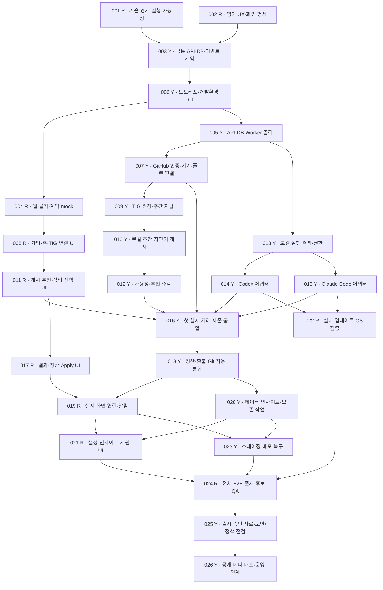

# Tokenisgold 전체 실행 워크플로우

최신 역할/실행 순서는 [NOW](NOW.md), 두 사람 실사용은 [TRY_TOGETHER](../TRY_TOGETHER.md)를 우선 읽는다. TH-029가 초기 거래 연결을 제공하며 륜호는 TH-030 웹 브랜치에서 이어간다. 아래 TH-002/027 언급은 이전 분해 기록이다.

이전 실행 변경: 사용자의 즉시 구현 요청으로 [TH-027](tasks/TH-027.md)에서 Day 1~4 핵심을 통합 선행 구현했다. 아래 그래프/일정은 원래 분해 기준이고, 실제 포함 범위와 잔여 조건은 [구현 보고](../verification/TH-027-day4.md)를 먼저 따른다. TH-002 후속 구현은 TH-027을 기반으로 하며 륜호는 먼저 PR #3를 리뷰한다.

이 문서는 2026-09-09 유찬의 “전체 워크플로우와 TODO, 의존성을 고려해 워크트리와 각 노드 배정” 요청을 반영한다.
기존 제품 P-001~066은 유지한다. 최종 제품 변경·병합·출시는 유찬이 결정한다.
작업별 상세 TODO·인수 조건·범위는 [BOARD](BOARD.md)의 TH 문서가 기준이다. 아래 일정은 상대적 목표이며 검증 전 10일 출시를 보장하지 않는다.

## 전체 의존성 그래프

Y=유찬, R=륜호. 화살표는 선행 작업 완료가 필요하다는 뜻이다. 같은 담당자의 여러 노드가 열려도 구현은 한 번에 하나만 한다.
화면 노드는 명시된 mock 범위에서 서버와 독립적이며, 실제 연결은 TH-016/019/021/024에서 검증한다.



## 반드시 합쳐서 통과할 지점

| 합류점 | 유찬 결과 | 륜호 결과 | 다음으로 넘어가는 조건 |
|---|---|---|---|
| TH-003 계약 | 기술 경계/실험 | 7개 화면/API 요구 | 상태·필드·실패 흐름을 같은 버전으로 합의 |
| TH-016 첫 거래 | 인증/원장/게시/매칭/양 AI 실행 | 게시·추천·진행 화면 | 두 계정으로 Yes부터 실제 Git 제출까지 연결 |
| TH-019 결과 처리 | 검사/48시간 정산/환불/Git 적용 | 결과/정산 UI | 실 API에서 승인·환불·자동 지급·재연결 확인 |
| TH-024 출시 후보 | 데이터·배포·복원 | 설정/통계·OS 설치·화면 | 신규 계정 전체 거래와 실패/복구 테스트 통과 |
| TH-025/026 공개 출시 | 정책/보안/비용 증거와 배포 | QA 결과·외부 smoke | 유찬 출시 승인, 배포 후 가입/거래 확인 |

## 10일 목표 일정과 사람별 실행 순서

Day 1은 기술 검증과 UX 작업을 함께 시작하는 기준일이다. 실제 달력 마감은 두 사람의 착수 기록으로 정하며 이미 지나간 일을 가상 완료로 표시하지 않는다.
표의 같은 칸에 작업이 여럿이면 왼쪽부터 순차 진행한다. 리뷰는 병행한다.

| 일차 | 유찬 | 륜호 | 하루 결과/조건 |
|---|---|---|---|
| 1 | 001 기술 검증/스택 선택 | 002 영어 UX | 실행 장애물·화면 요구 확정 |
| 2 | 003 계약 → 006 공통 환경 → 005 서버 골격 | 계약 리뷰 → 004 웹 mock | 같은 계약/환경에서 개발 |
| 3 | 013 격리 → 007 인증 | 008 가입/홈 UI | 격리와 플랜 신뢰 실패를 일찍 발견 |
| 4 | 009 원장 → 010 초안/게시 | 011 게시/추천 UI | 게시와 TIG 예치 재시도 안전성 |
| 5 | 012 추천/수락 → 014 Codex | 017 결과 UI | 작업 실행 경로와 결과 UI 준비 |
| 6 | 015 Claude → 016 실제 거래 통합 | 022 설치/OS 검증 착수, 통합 UI 지원 | 양 AI의 실제 제출, 설치 문제 수집 |
| 7 | 018 정산 → 020 데이터 | 019 실 API/알림 연결, 022 마무리 | 승인/환불/자동 지급 완성 |
| 8 | 023 스테이징/복원 | 021 설정/통계 → 024 QA 착수 | 실제 환경에서 전체 흐름 검증 |
| 9 | 024 결함 수정 지원 → 025 출시 근거 검토 | 024 QA/회귀 | 기능 동결, 출시 차단 결함 해소 |
| 10 | 026 승인 후 배포/롤백 대기 | 외부 smoke/문의 안내/초기 관찰 | 공개 베타 URL와 운영 인계 |

유찬의 서버·CLI·보안 작업이 임계 경로다. 특히 Day 2/4/7은 밀도가 높다. 완료 기준을 낮춰 일정에 맞추지 않는다.
Day 1~3 검증이 막히거나 일정이 밀리면 조율 AI가 원인/영향/변경안을 제시하고 유찬이 재배정 또는 범위/날짜 변경을 결정한다.
Windows 네이티브는 TH-022에서 병행 검증하며 기존 P-054대로 지연 시 별도 표시한다. WSL2 성공을 native Windows 성공으로 기록하지 않는다.

## 워크트리와 PR 진행

- 유찬 시작 폴더: `/mnt/imclab_data2/yccho/TIG/.worktrees/TH-001-feasibility`, `docs/TH-001-feasibility`. 기존 검증 작업을 계속한다.
- 륜호 시작 폴더: `/mnt/imclab_data2/yccho/TIG/.worktrees/TH-002-english-ux`, `feat/TH-002-english-ux`. 이번 계획을 포함한 유찬 브랜치에서 생성한다.
- 원본 `/mnt/imclab_data2/yccho/TIG`는 기존 정책 브랜치 그대로 보존한다. 아직 main에 새 문서가 병합되지 않았다.
- 현재 PR 순서: 정책 #1 → 검증/계획 #2 → UX PR(작성 시 #2의 head를 base로 지정). 선행 PR 병합 후 차이를 확인하고 UX PR의 base를 main으로 바꾼다. squash 병합으로 이전 diff가 다시 나오면 자신의 깨끗한 새 브랜치에 UX 커밋만 옮겨 PR을 정리한다. 다른 사람 브랜치는 force push하지 않는다.
- 앞으로는 한 노드를 끝낸 뒤 최신 main에서 그다음 작업별 브랜치/worktree를 만든다. 아직 시작할 수 없는 24개 작업 폴더를 미리 만들지 않는다.
- worktree는 코드 폴더를 분리한다. 같은 clone의 worktree는 Git 저장소 설정과 인증을 공유하므로 계정을 분리하지 않는다. 륜호는 자기 컴퓨터/계정의 별도 clone을 권장한다. 현재 서버 폴더 생성이 륜호 로그인이나 작업 전달 완료를 뜻하지 않는다.

륜호가 자기 컴퓨터에서 최초로 가져오기:

```bash
git clone https://github.com/timeistoken/TaskHub.git Tokenisgold
cd Tokenisgold
git fetch origin
git switch --track origin/feat/TH-002-english-ux
```

자신의 clone에서만 커밋 신원을 설정하고 본인 GitHub 계정으로 인증한다. 이 서버의 공유 clone 신원을 륜호로 덮어쓰지 않는다.
나중에 후속 노드를 시작하는 예시(선행 병합 확인 후, 경로/브랜치가 없을 때):

```bash
git fetch origin
git worktree add .worktrees/TH-003-contracts -b feat/TH-003-contracts origin/main
```

## AI가 매번 수행할 조율

1. fetch 후 main과 열린 PR의 작업 문서·커밋·검사·리뷰·병합 증거를 읽는다.
2. 작업 하나당 담당자 한 명, 상대 리뷰어, 선행 완료, 수정 경로 충돌을 확인한다.
3. 각자 다음 작업 하나와 완료 조건을 알린다. TH-001과 TH-002가 지금의 시작 작업이다.
4. 시작/중단/리뷰 요청 시 작업 문서에 변경·명령/결과·장애물·다음 행동·기준 SHA/계약 버전·PR을 기록하고 push한다.
5. 계약 변경은 유찬 담당 PR로 먼저 반영하고 륜호가 mock/UI 영향을 검토한다. 루트 설정/lockfile/CI/migration도 유찬이 통합한다.
6. CI+상대 리뷰 후 유찬이 병합한다. 다음 조율에서 병합 증거를 기록해 DONE 처리하고 후속 노드를 연다.

작업 기록에는 필요한 결정 이유/산출물만 남기고 개인 AI 대화 전문·비밀정보는 남기지 않는다. Codex/Claude Code를 바꿔도 같은 문서를 읽는다.
점검 스크립트는 로컬 문서를 읽을 뿐 원격 사람의 작업을 실시간 감시하거나 자동 실행하지 않는다.

## 사용자가 경험하는 완료 흐름

요청자: “Post this project for 1,000 TIG.” → 초안/필수 맥락으로 게시·예치 → 웹에서도 같은 상태 확인.
수행자: “Find me a task.” → 한 건 추천 → “Yes.” → 로컬 AI 실행/검사/내역서/Git 제출.
요청자: 결과를 승인하면 지급, 검토 중 문제 신고는 TIG 복구 후 종료, 48시간 미응답은 자동 지급. 코드는 별도 “Apply changes”.
이 흐름과 신규 가입·설치·실패 복구가 TH-024를 통과해야 공개 베타 후보가 된다.
